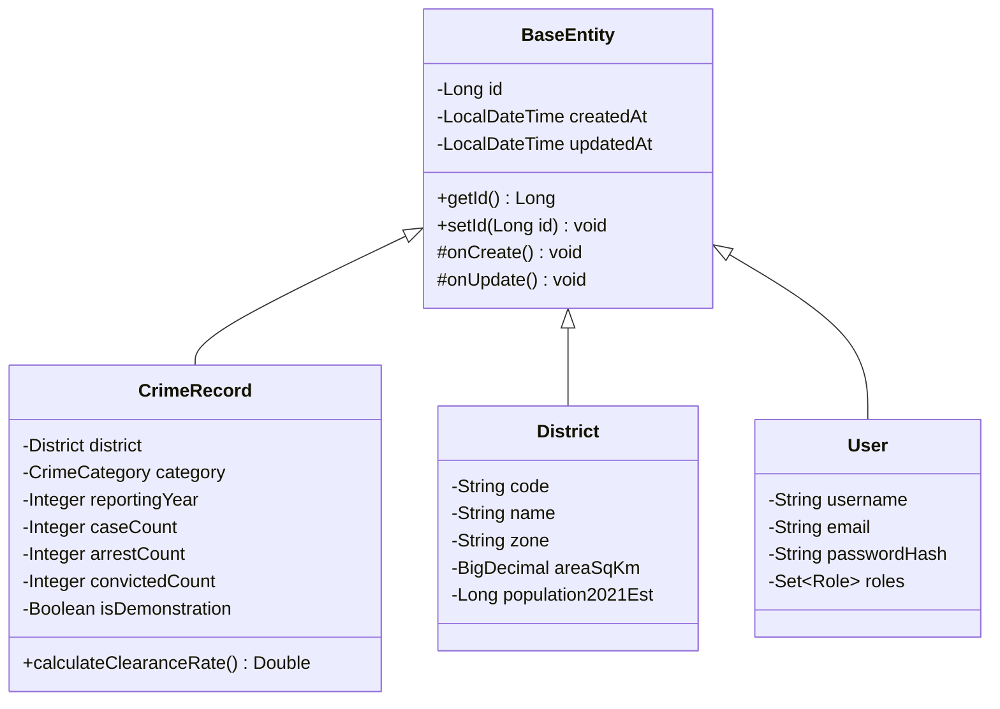
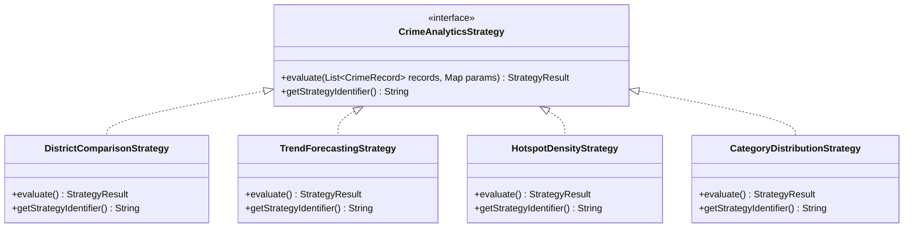
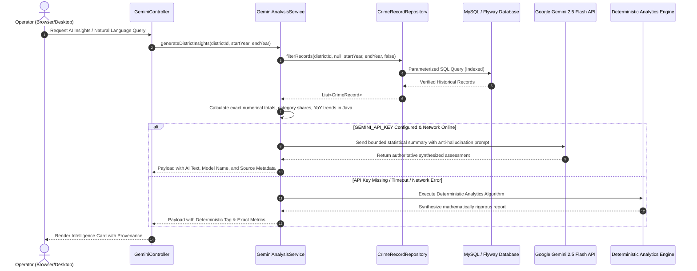

# CrimeScope AI — System Architecture & Academic OOPS Documentation
## Tamil Nadu Crime Intelligence Command Center

### 1. Academic OOPS Microproject Compliance

This application fulfills all requirements of an Advanced Object-Oriented Programming (OOPS) microproject in Java 21, integrating relational persistence (Spring Data JPA and raw JDBC), desktop user interface (Java Swing), secure RESTful microservices, and grounded Artificial Intelligence.

#### A. Encapsulation
- **Strict Private State**: All entity fields (`CrimeRecord`, `User`, `District`, `CrimeCategory`, `DatasetImport`) are strictly declared `private` with validated mutators and accessors.
- **Defensive Invariant Protection**:
  - `CrimeRecord.calculateClearanceRate()` calculates chargesheet resolution percentages with non-zero denominator guards (`caseCount > 0`) to prevent division by zero or NaN artifacts.
  - Verification states (`VERIFIED`, `DEMONSTRATION`) are encapsulated within domain enums.
  - Immutability of DTOs and result payloads (`StrategyResult`) preventing unintended side effects.

#### B. Inheritance
- **Unified Entity Hierarchy**:
  - `BaseEntity` (`@MappedSuperclass`) provides generic identity (`id`), created timestamp (`createdAt`), updated timestamp (`updatedAt`), and lifecycle hooks (`@PrePersist`, `@PreUpdate`).
  - `User`, `District`, `CrimeCategory`, `DatasetSource`, `DatasetImport`, `CrimeRecord` inherit from `BaseEntity`.

#### C. Abstraction
- **Repository Abstraction**: Spring Data `CrimeRecordRepository` abstracts low-level relational SQL execution, providing type-safe JPQL aggregations and pagination.
- **Strategy Abstraction**: `CrimeAnalyticsStrategy` interface specifies the contract for analytical calculations, hiding the internal complexities of geographical density mathematics, time-series slope formulas, and category shares.

#### D. Polymorphism (Strategy Pattern)
- Four interchangeable analytical strategy implementations can be invoked dynamically:
  1. `DistrictComparisonStrategy`: Multi-district metric differential and risk index calculation.
  2. `TrendForecastingStrategy`: Moving average and period-over-period percentage trajectory.
  3. `HotspotDensityStrategy`: Spatial incident density per 100 square kilometers and dynamic threat tier assignment (`LOW`, `MODERATE`, `ELEVATED`, `HIGH`, `CRITICAL`).
  4. `CategoryDistributionStrategy`: Proportional crime shares and severity-weighted threat indexing (`SeverityLevel.weight`).

---

### 2. File Handling Architecture (RFC 4180 CSV Engine)

The `CrimeCsvHandler` implements a finite-state machine CSV parser and serializer:
- **No Naive String Splitting**: Complies with RFC 4180; handles commas within quotation marks, multiline fields, and escaped quotes (`""`).
- **UTF-8 and BOM Support**: Safely discards Byte Order Marks (`\uFEFF`) and operates strictly in `StandardCharsets.UTF_8`.
- **Malformed-Row Diagnostics**: Isolates corrupt or invalid rows with line numbers, raw content, and specific failure causes (`MalformedRowRecord`), preventing partial corruption of database state.
- **SHA-256 Duplicate Check**: Hashes composite fields (District + Category + Year + Month + Case Count) to reject duplicate submissions.

---

### 3. Dual-Database Connectivity & Educational JDBC

Fulfills both modern enterprise patterns and academic evaluation requirements:
1. **Spring Data JPA & Hibernate**: Object-relational mapping, versioned migrations via Flyway, and connection pooling.
2. **Educational Direct JDBC (`EducationalJdbcCrimeDao` / `DirectJdbcDemoRunner`)**:
   - Explicit `java.sql.Connection` acquisition from the DataSource pool.
   - Parameterized `PreparedStatement` preventing SQL injection.
   - Cursor-based `ResultSet` navigation.
   - Diagnostic metadata extraction (isolation level, auto-commit state, driver version, query execution time in milliseconds).

---

### 4. Gemini AI Grounding Architecture

