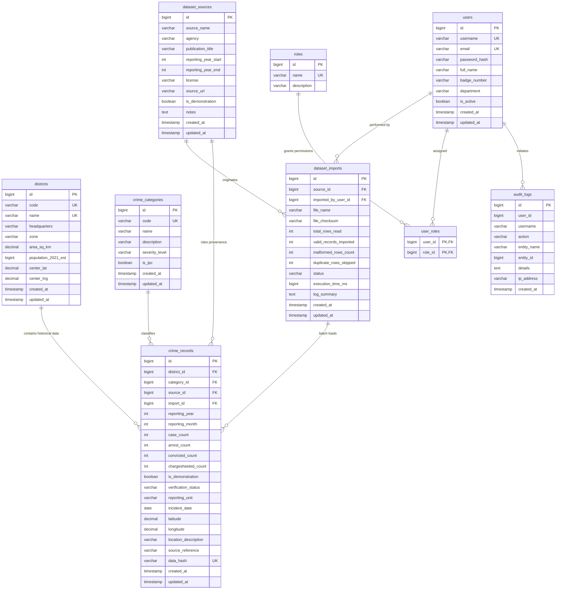

# CrimeScope AI — Database Schema & Data Dictionary
## Relational Persistence Architecture for Tamil Nadu Crime Intelligence

---

## 1. Entity-Relationship (ER) Architecture

The CrimeScope AI persistence tier is structured around normalized third-normal-form (3NF) relational tables supporting historical crime statistics, administrative districts, offense categories, batch file imports, and audit trails.



---

## 2. Table Specifications & Data Dictionary

### Table: `districts`
Represents the 38 administrative revenue districts of Tamil Nadu, their zonal division, geographic centroids, and estimated census populations.

| Column Name | Data Type | Nullable | Default | Description |
|:---|:---|:---:|:---|:---|
| `id` | `BIGINT AUTO_INCREMENT` | No | — | Primary Key |
| `code` | `VARCHAR(10)` | No | — | Unique district identifier (e.g., `CHN`, `CBE`, `MDU`) |
| `name` | `VARCHAR(100)` | No | — | Official district name (e.g., `Chennai`, `Madurai`) |
| `headquarters` | `VARCHAR(100)` | No | — | District administrative headquarters |
| `zone` | `VARCHAR(50)` | No | — | Administrative zone (`NORTH`, `CENTRAL`, `WEST`, `SOUTH`, `CHENNAI`) |
| `area_sq_km` | `DECIMAL(10, 2)` | Yes | `NULL` | Total geographic area in square kilometers |
| `population_2021_est` | `BIGINT` | Yes | `NULL` | Estimated 2021 population for per-capita analysis |
| `center_lat` | `DECIMAL(9, 6)` | Yes | `NULL` | Geographic center latitude |
| `center_lng` | `DECIMAL(9, 6)` | Yes | `NULL` | Geographic center longitude |
| `created_at` | `TIMESTAMP` | No | `CURRENT_TIMESTAMP` | Entity creation timestamp |
| `updated_at` | `TIMESTAMP` | No | `CURRENT_TIMESTAMP` | Last updated timestamp |

**Indexes:**
- `PRIMARY KEY (id)`
- `UNIQUE INDEX (code)`
- `UNIQUE INDEX (name)`
- `INDEX idx_districts_zone (zone)`

---

### Table: `crime_categories`
Standardized categorization of offences covering Indian Penal Code (IPC) and Special & Local Laws (SLL).

| Column Name | Data Type | Nullable | Default | Description |
|:---|:---|:---:|:---|:---|
| `id` | `BIGINT AUTO_INCREMENT` | No | — | Primary Key |
| `code` | `VARCHAR(50)` | No | — | Unique category code (`VIOLENT`, `PROPERTY`, `CYBER`, etc.) |
| `name` | `VARCHAR(120)` | No | — | Human-readable category title |
| `description` | `VARCHAR(500)` | Yes | `NULL` | Statutory statutory references (IPC/SLL sections) |
| `severity_level` | `VARCHAR(20)` | No | `'MEDIUM'` | Severity tier (`LOW`, `MEDIUM`, `HIGH`, `CRITICAL`) |
| `is_ipc` | `BOOLEAN` | No | `TRUE` | `TRUE` for IPC offenses, `FALSE` for Special & Local Laws |
| `created_at` | `TIMESTAMP` | No | `CURRENT_TIMESTAMP` | Creation timestamp |
| `updated_at` | `TIMESTAMP` | No | `CURRENT_TIMESTAMP` | Last updated timestamp |

---

### Table: `crime_records`
Core fact table storing historical and verified incident summaries aggregated by district, category, year, and month.

| Column Name | Data Type | Nullable | Default | Description |
|:---|:---|:---:|:---|:---|
| `id` | `BIGINT AUTO_INCREMENT` | No | — | Primary Key |
| `district_id` | `BIGINT` | No | — | FK to `districts.id` |
| `category_id` | `BIGINT` | No | — | FK to `crime_categories.id` |
| `source_id` | `BIGINT` | Yes | `NULL` | FK to `dataset_sources.id` |
| `import_id` | `BIGINT` | Yes | `NULL` | FK to `dataset_imports.id` |
| `reporting_year` | `INT` | No | — | Calendar year (e.g., 2018–2023) |
| `reporting_month` | `INT` | Yes | `NULL` | Month of reporting (1–12), or `NULL` if annual total |
| `case_count` | `INT` | No | `0` | Number of registered First Information Reports (FIRs) |
| `arrest_count` | `INT` | Yes | `NULL` | Total persons arrested |
| `convicted_count` | `INT` | Yes | `NULL` | Total convictions secured |
| `chargesheeted_count` | `INT` | Yes | `NULL` | Cases where chargesheet was filed |
| `is_demonstration` | `BOOLEAN` | No | `FALSE` | Strict isolation: `TRUE` for demo testbeds, `FALSE` for verified records |
| `verification_status` | `VARCHAR(30)` | No | `'VERIFIED'` | `VERIFIED`, `UNVERIFIED`, `DEMONSTRATION`, `REJECTED` |
| `reporting_unit` | `VARCHAR(100)` | Yes | `'District Police Office'` | Police station, cyber cell, or reporting wing |
| `incident_date` | `DATE` | Yes | `NULL` | Specific date if record represents a single event |
| `latitude` | `DECIMAL(9, 6)` | Yes | `NULL` | Valid geographic coordinate (never assumed to be district center) |
| `longitude` | `DECIMAL(9, 6)` | Yes | `NULL` | Valid geographic coordinate |
| `location_description` | `VARCHAR(255)` | Yes | `NULL` | Physical landmark or jurisdiction description |
| `source_reference` | `VARCHAR(150)` | Yes | `NULL` | Specific report chapter or publication citation |
| `data_hash` | `VARCHAR(64)` | Yes | `NULL` | SHA-256 hash of composite keys to prevent duplicate insertion |
| `created_at` | `TIMESTAMP` | No | `CURRENT_TIMESTAMP` | Entity creation timestamp |
| `updated_at` | `TIMESTAMP` | No | `CURRENT_TIMESTAMP` | Last updated timestamp |

**Indexes & Performance Optimization:**
- `INDEX idx_records_dist_year (district_id, reporting_year)`: High-speed filtering on district pages.
- `INDEX idx_records_cat_year (category_id, reporting_year)`: Accelerated crime category trend computations.
- `INDEX idx_records_year_month (reporting_year, reporting_month)`: Time-series query optimization.
- `INDEX idx_records_status (verification_status, is_demonstration)`: Fast isolation between verified and demonstration data.

---

### Table: `dataset_sources`
Tracks bibliographic and provenance metadata for crime statistics compendiums.

| Column Name | Data Type | Nullable | Default | Description |
|:---|:---|:---:|:---|:---|
| `id` | `BIGINT AUTO_INCREMENT` | No | — | Primary Key |
| `source_name` | `VARCHAR(150)` | No | — | Short name (e.g. `TN_POLICE_COMPENDIUM_2023`) |
| `agency` | `VARCHAR(150)` | No | — | Publishing authority (e.g. `Tamil Nadu Police Department`) |
| `publication_title`| `VARCHAR(255)` | No | — | Official title of publication |
| `reporting_year_start` | `INT` | No | — | First year covered by publication |
| `reporting_year_end` | `INT` | No | — | Final year covered by publication |
| `license` | `VARCHAR(100)` | No | `'Government Open Data License - India (GODL)'` | Licensing regime |
| `source_url` | `VARCHAR(500)` | Yes | `NULL` | Government URL or official repository link |
| `is_demonstration` | `BOOLEAN` | No | `FALSE` | Indicates synthetic educational test datasets |
| `notes` | `TEXT` | Yes | `NULL` | Methodological remarks and reconciliation notes |

---

### Table: `dataset_imports`
Audit and telemetry ledger for CSV batch file ingestion operations.

| Column Name | Data Type | Nullable | Default | Description |
|:---|:---|:---:|:---|:---|
| `id` | `BIGINT AUTO_INCREMENT` | No | — | Primary Key |
| `source_id` | `BIGINT` | Yes | `NULL` | FK to `dataset_sources.id` |
| `imported_by_user_id`| `BIGINT` | Yes | `NULL` | FK to `users.id` |
| `file_name` | `VARCHAR(255)` | No | — | Uploaded CSV filename |
| `file_checksum` | `VARCHAR(64)` | Yes | `NULL` | SHA-256 checksum of raw uploaded file |
| `total_rows_read` | `INT` | No | `0` | Total records scanned |
| `valid_records_imported` | `INT` | No | `0` | Clean records committed to `crime_records` |
| `malformed_rows_count` | `INT` | No | `0` | Rejected malformed lines |
| `duplicate_rows_skipped`| `INT` | No | `0` | Ignored duplicates based on composite hash |
| `status` | `VARCHAR(50)` | No | `'COMPLETED'` | `COMPLETED`, `PARTIAL_SUCCESS`, `FAILED` |
| `execution_time_ms`| `BIGINT` | No | `0` | Total processing time in milliseconds |
| `log_summary` | `TEXT` | Yes | `NULL` | Detailed breakdown of warnings or errors |

---

### Table: `audit_logs`
Immutable regulatory logging tracking every modification, insertion, and deletion.

| Column Name | Data Type | Nullable | Default | Description |
|:---|:---|:---:|:---|:---|
| `id` | `BIGINT AUTO_INCREMENT` | No | — | Primary Key |
| `user_id` | `BIGINT` | Yes | `NULL` | ID of the acting operator |
| `username` | `VARCHAR(50)` | Yes | `NULL` | Username or operator session |
| `action` | `VARCHAR(50)` | No | — | Action verb (`CREATE`, `UPDATE`, `DELETE`, `CSV_IMPORT`) |
| `entity_name` | `VARCHAR(50)` | No | — | Target entity (`CrimeRecord`, `DatasetImport`) |
| `entity_id` | `BIGINT` | Yes | `NULL` | Primary key of modified entity |
| `details` | `TEXT` | Yes | `NULL` | JSON or textual diff of state changes |
| `ip_address` | `VARCHAR(45)` | Yes | `NULL` | IPv4 or IPv6 of calling client |
| `created_at` | `TIMESTAMP` | No | `CURRENT_TIMESTAMP` | Action timestamp |

---

## 3. Versioned Database Migrations (Flyway)

CrimeScope AI utilizes Flyway to manage reproducible, version-controlled database evolutions:

1. **`V1__create_initial_schema.sql`**:
   - Creates `districts`, `crime_categories`, `roles`, `users`, `user_roles`, `dataset_sources`, `dataset_imports`, `crime_records`, and `audit_logs`.
   - Defines foreign key constraints, unique constraints, and high-performance indexes.
2. **`V2__seed_districts_and_categories.sql`**:
   - Seeds all 38 districts of Tamil Nadu with geographic codes, centroids, administrative zones, and 2021 population estimates.
   - Seeds 7 standardized crime categories with severity ratings.
   - Seeds default roles (`ROLE_ADMIN`, `ROLE_ANALYST`, `ROLE_OPERATOR`) and administrative user accounts.
3. **`V3__seed_historical_crime_data.sql`**:
   - Seeds 1,611 granular historical and demonstration crime records spanning 2018 through 2023.
   - Implements realistic trajectories (e.g. rising cyber offenses, lockdown dips in property crime in 2020) and clearance statistics.

---

## 4. Multi-Database Configuration

### Development & In-Memory Mode (H2 in MySQL Mode)
```properties
spring.datasource.url=jdbc:h2:mem:crimescopedb;DB_CLOSE_DELAY=-1;MODE=MySQL;DATABASE_TO_LOWER=TRUE;CASE_INSENSITIVE_IDENTIFIERS=TRUE
spring.datasource.driverClassName=org.h2.Driver
spring.jpa.database-platform=org.hibernate.dialect.H2Dialect
spring.flyway.enabled=true
```
- Fully self-contained: runs out-of-the-box without requiring an external MySQL daemon.
- 100% compatible with MySQL SQL DDL syntax.

### Production Mode (MySQL 8.x)
```properties
# Activated with: --spring.profiles.active=mysql
spring.datasource.url=jdbc:mysql://${DB_HOST:localhost}:${DB_PORT:3306}/${DB_NAME:crimescopedb}?useSSL=false&allowPublicKeyRetrieval=true&serverTimezone=UTC
spring.datasource.username=${DB_USER:crimescope_user}
spring.datasource.password=${DB_PASS:crimescope_password}
spring.jpa.database-platform=org.hibernate.dialect.MySQLDialect
```
